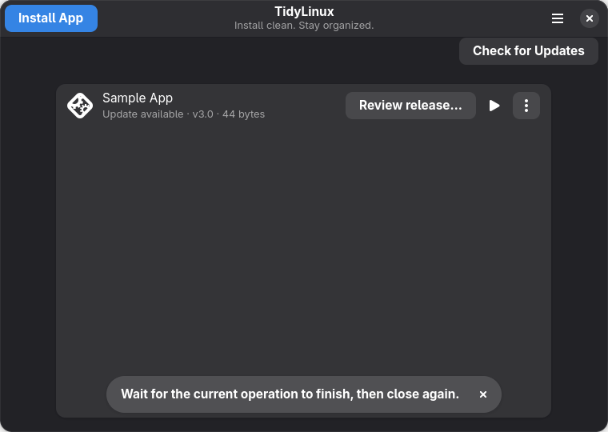
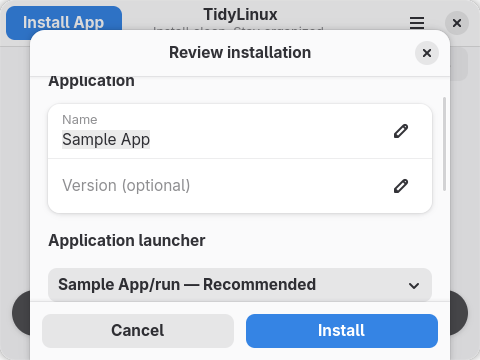
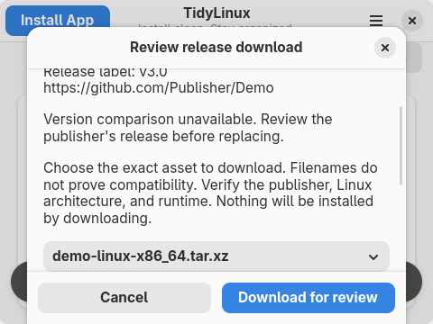
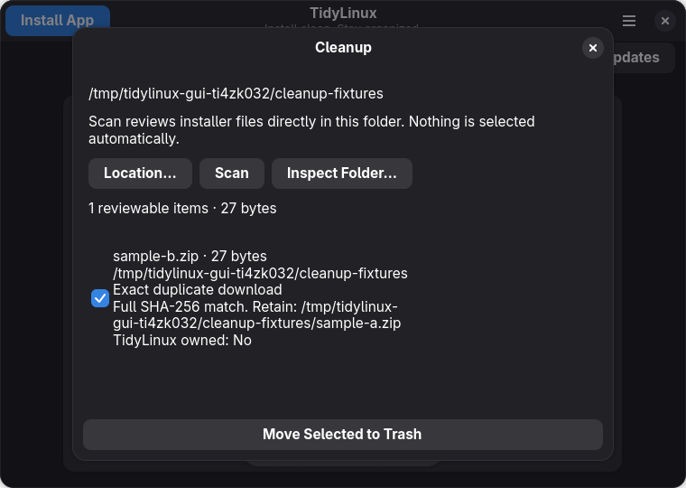

# TidyLinux

**Install clean. Stay organized.**

TidyLinux is a lightweight GNOME-native tool for managing portable Linux applications and installation leftovers. It keeps reviewed application bundles in user-owned storage, creates desktop shortcuts, and helps you review updates and duplicate downloads.

## Installation

**The V1.4 RPM is not published yet.** There is no official Fedora repository package. Once a maintainer publishes a release, download its RPM and matching SHA-256 file from the [project releases](https://github.com/Ishank307/Tidy_Linux/releases), verify the checksum, and install the local RPM with DNF. See the [installation guide](docs/INSTALLATION.md) for exact local-build commands and source setup.

For now, run from source:

```bash
sudo dnf install git python3 python3-gobject gtk4 libadwaita
git clone https://github.com/Ishank307/Tidy_Linux.git
cd Tidy_Linux
python3 scripts/run.py
```

The public default branch may lag this uncommitted development work.

## Screenshots

Real captures of the current GTK application with disposable fixture apps:






Screenshots use test data, not third-party endorsements. Compact reviews scroll; [additional dark-mode captures](docs/images) are included.

## Features

- Install portable archives and AppImages with executable review and GNOME shortcuts.
- Launch and uninstall managed applications without removing external settings.
- Update from a local archive and retain one version for rollback.
- Explicitly link GitHub Releases sources, check for updates on demand, select an asset, and separately approve download and installation.
- Review SHA-256 duplicate installers, tracked archives, temporary downloads, and manually selected folders with Smart Cleanup.
- Move selected cleanup candidates to native Trash after confirmation.

No startup update checks, automatic cleanup, polling, telemetry, or background service.

## Quick start

1. Open **TidyLinux** from GNOME Applications after RPM installation.
2. Choose or drop a portable archive or AppImage.
3. Review the executable, application name, and optional version; confirm installation.
4. Launch from TidyLinux or its GNOME shortcut.
5. Use **Check for Updates** whenever you want to check linked release sources.
6. Open **Cleanup** from the main menu, choose a location, Scan, review, select, and confirm Trash.

## Supported formats

Installation supports `.tar.gz`, `.tgz`, `.tar.xz`, `.zip`, and supported Linux AppImages. Cleanup also considers `.rpm` and `.deb` files as downloads; it does not install them or modify DNF/Flatpak installations.

Archives containing symlinks, hard links, device nodes, traversal paths, sparse files, or excessive expansion are rejected. Bundles needing unsupported links, system installation, or unavailable libraries may not work. AppImages can require FUSE or other host dependencies. Optional `squashfs-tools` enables embedded AppImage artwork inspection without executing the image.

## Security and limitations

Applications run with your normal user permissions. TidyLinux does **not** sandbox them. Archive validation, a GitHub source, and a checksum do not prove publisher authenticity. Verify sources independently. Internet update requests require explicit actions; downloading and installation require separate approvals. Cleanup never permanently deletes files, and files in Trash may still occupy storage. Some application bundles are incompatible with your system.

## Documentation

- [Installation](docs/INSTALLATION.md) and [user guide](docs/USER_GUIDE.md)
- [Updates and rollback](docs/UPDATES.md)
- [Smart Cleanup](docs/CLEANUP.md)
- [Troubleshooting](docs/TROUBLESHOOTING.md) and [security notes](docs/SECURITY.md)
- [Architecture](docs/ARCHITECTURE.md) and [Fedora packaging](packaging/fedora/README.md)
- [V1.4 release checklist](docs/V1_4_RELEASE_CHECKLIST.md)

## Contributing and license

See [CONTRIBUTING.md](CONTRIBUTING.md). TidyLinux is licensed under [GPL-3.0-or-later](LICENSE).
