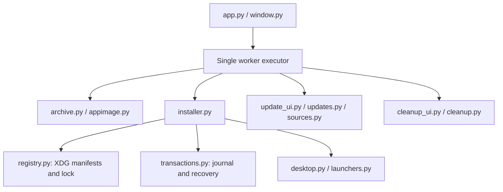

# Architecture

A single Python package uses system PyGObject, GTK4, and Libadwaita. No daemon or scheduler is present.

The window submits blocking work to one executor and marshals results/progress to the GTK main thread. User actions authorize checks, downloads, installation, scanning, and Trash independently. Constructing the update provider performs no requests.

Archive inspection enforces path/type/size bounds before extraction; installation rechecks the source snapshot. AppImage inspection does not execute the image. Manifests record identity, source checksum, paths, and desktop ownership. Desktop output escapes command arguments and validates ownership before replacement/removal.

`Paths` keeps managed state beneath `$XDG_DATA_HOME/tidylinux` (default `~/.local/share/tidylinux`); managed shortcuts use `$XDG_DATA_HOME/applications`. Private managed directories reject unsafe ownership/modes and symlink substitutions. A nonblocking filesystem lock serializes operations. Journaled updates retain a complete rollback bundle; recovery preserves ambiguous state.

Online downloads use constrained HTTPS GitHub endpoints, bounded reads, and checksum/archive validation. Source metadata is separate from bundle snapshots. Cleanup reuses manifests, download markers, and locks; it only proposes candidates and uses native Trash after explicit approval. It does not replace transaction recovery.

RPM packaging owns system code, `/usr/bin/tidylinux`, desktop/icon/AppStream files, and packaged documentation only. It has no user-data scriptlets. `src/tidylinux/__init__.py` is the authoritative version; setuptools reads it dynamically, and source archive creation verifies the spec and AppStream agree.
